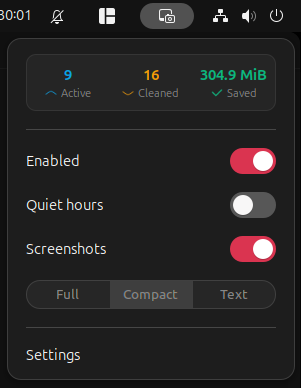
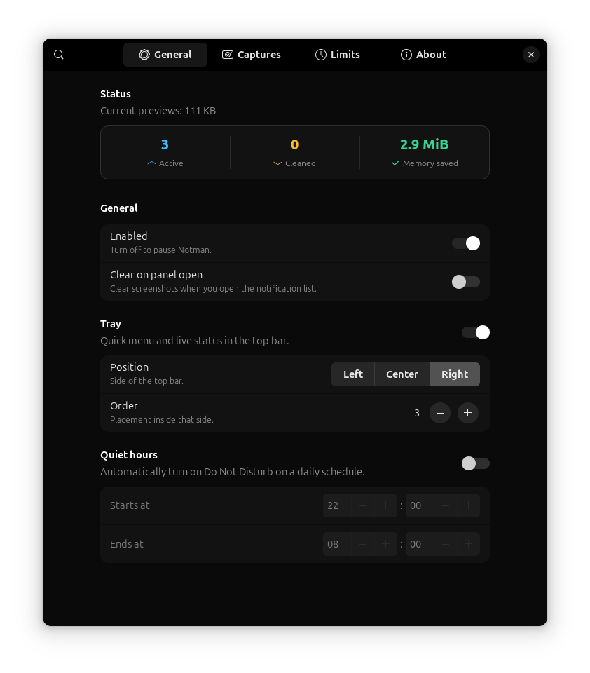

# Notman

**Notification manager for GNOME Shell 46, 47, and 48.**

Notman fixes GNOME Shell's screenshot & Do-Not-Disturb notification memory leaks and exposes the notification policies GNOME keeps hidden — with compact downscaled previews (~36 KB vs ~32 MiB at 4K), per-app rules, burst protection, scheduled Quiet hours, and native libadwaita Preferences.

## Features

- **Compact screenshot thumbnails**: Downscales screenshot previews off-thread to ~128 px (~36 KB, **99.8% less RAM** at 4K) with burst backpressure limits and clean fallback to text-only.
- **Screenshot & screen-recording controls**: Discard on arrival, cap retained count, auto-dismiss by age, enforce a memory limit, or clear screenshots when opening the calendar panel.
- **DND transient-notification cleanup**: Automatically expires short-lived notifications from other apps that get stuck during Do Not Disturb, while always protecting critical, feedback, and currently shown alerts.
- **Burst limit & per-app rules**: Collapse rapid notification storms per app within a sliding window, or configure custom mute, count, and expiry overrides by app name or installed-app picker.
- **Global retention**: Optional cross-app notification cap and age-based auto-dismiss.
- **Scheduled Quiet hours**: Automatically toggle GNOME Do Not Disturb on a daily schedule (supporting overnight windows) without overriding manual DND.
- **Native tray & Preferences**: Compact top-bar menu with live **Active / Cleaned / Saved** stats, 1-click **Full | Compact | Text** pill switcher, configurable panel position/order, tabbed searchable Preferences, and JSON import/export.

## Screenshots

<!-- Drop your tray and Preferences screenshots into docs/tray.png and docs/prefs.png -->

| Top-bar tray menu                  | Preferences                           |
| ---------------------------------- | ------------------------------------- |
|  |  |

## Install

### From GitHub Releases

Download `notman.zip` from [Releases](https://github.com/Kbgjtn/notman/releases) and install:

```sh
gnome-extensions install --force notman.zip
gnome-extensions enable notman@kbgjtn.github.io
```

On X11, reload with `Alt+F2` → `r` (on Wayland, log out and back in).

### From source

```sh
make             # compile TypeScript into dist/
make check       # schema, imports, scripts, lint, unit tests, typecheck
make qa-xvfb     # isolated GNOME Shell 46 smoke test (private Xvfb + D-Bus)
make dev-install # symlink dist/ into ~/.local/share/gnome-shell/extensions/
gnome-extensions enable notman@kbgjtn.github.io
```

If the shell UI ever becomes unusable, disable Notman over D-Bus:

```sh
gdbus call --session --dest org.gnome.Shell --object-path /org/gnome/Shell \
  --method org.gnome.Shell.Extensions.DisableExtension notman@kbgjtn.github.io
```

## Compatibility

| GNOME | Adapter | Notes                                                                              |
| ----- | ------- | ---------------------------------------------------------------------------------- |
| 46    | `v46`   | Primary dev/QA target; upstream notification path verified against source          |
| 47    | `v47`   | Supported via shared GNOME 46+ base adapter                                        |
| 48    | `v48`   | Supported; adapts GNOME 48 `St.ImageContent.set_bytes(coglContext, ...)` signature |
| < 46  | none    | Older `MessageTray` / legacy `imports.ui.*` APIs                                   |

Node/npm is required **only at build time** — the installed extension is plain JS.

## Why Notman exists

This is a measurable memory leak in GNOME Shell, not a problem with the screenshot tool or files on disk:

1. `js/ui/screenshot.js` turns each capture into an `St.ImageContent` holding `pixbuf.read_pixel_bytes()` at full width × height in RGBA8888 (~31.6 MiB for a 3840×2160 screenshot).
2. Every screenshot creates a **new `MessageTray.Source`** with `isTransient: true`, bypassing `MAX_NOTIFICATIONS_PER_SOURCE`.
3. Transient notifications are only destroyed in `MessageTray._hideNotificationCompleted()`, which only runs after a banner is shown and hidden.
4. With Do Not Disturb enabled, `_onNotificationRequestBanner()` returns early for non-critical notifications — no banner is shown, so every full-size texture stays retained for the lifetime of the shell session.

### Measured proof (GNOME Shell 46, X11, DND on, 10 × `Shift+Print`)

| Measurement                                               | gnome-shell RSS                                  |
| --------------------------------------------------------- | ------------------------------------------------ |
| Before                                                    | 656,484 kB                                       |
| After 10 screenshots (unmanaged)                          | 1,096,748 kB (**+440,264 kB**)                   |
| Estimated thumbnails at `2560×1440` (`leak`, 9 shots)     | **126.6 MiB**                                    |
| Estimated thumbnails at `2560×1440` (`compact`, 10 shots) | **0.4 MiB** (36.8 KB/shot, **99.75% reduction**) |

Raw samples and full benchmark breakdown live in [results/report.md](results/report.md).

## Measurement & benchmarks

`tools/measure.sh` fires 10 `Shift+Print` screenshots on one pinned CPU under a 60-second timeout and records `gnome-shell` RSS per shot in `results/baseline.csv`.

`tools/benchmark.sh` runs named cases (`leak`, `leak-dndoff`, `drop`, `compact`, `text`, `text-dndoff`, `limit`, `expire`, `budget`, `cap`, `combined`, `unlimited`) with screenshot disk saving disabled, restoring all settings and display modes on exit:

```sh
make baseline
make benchmark CONFIRM=1 CASE=compact RES=2560x1440 RUNS=2
make report   # writes results/report.md
```

## Layout

```text
extension.ts, prefs.ts   entry points (shell lifecycle and GTK4/Adw prefs)
stylesheet.css           tray pill toggle and stat-card styles
src/                     bridge, compat adapters (v46–v48), rules, quiet hours, config I/O, tray UI, D-Bus
schemas/                 GSettings schema
tests/                   Vitest unit tests (104 tests)
tools/                   isolated Xvfb QA and bounded benchmark harness
dist/                    generated, gitignored
```

## License

[GPL-3.0-or-later](LICENSE)
